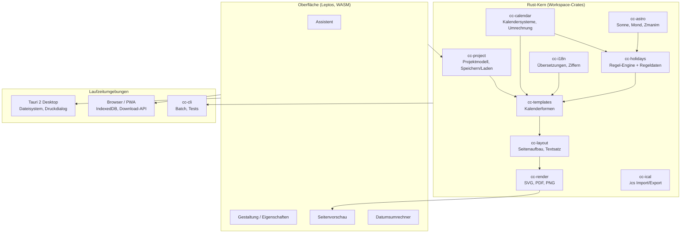
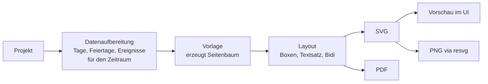

# CalendarCraft – Architektur und Tech-Stack

Version 0.2 (Entwurf), Stand 17.10.2026

Änderungen gegenüber 0.1: ohne islamischen Kalender und arabische Schrift; Zmanim, Ortsdatenbank, Fotos und hebräische RTL-Oberfläche ergänzt; Hosting über GitHub.

## 1. Leitlinien

1. Ein Rust-Kern für alles Fachliche: Kalenderrechnung, Feiertage, Layout, Rendering, Export. Er hat keine Abhängigkeit zu Oberfläche oder Betriebssystem und kompiliert sowohl nativ als auch nach `wasm32-unknown-unknown`.
2. Eine Oberfläche für Browser und Desktop. Sie ist in Rust geschrieben (Leptos), läuft im Browser als WebAssembly und in der Desktop-App innerhalb der Tauri-WebView.
3. Vorschau und Export kommen aus derselben Render-Pipeline. Die Vorschau ist ein SVG bzw. Rasterbild der echten Seite, kein nachgebautes HTML. Damit sieht der Druck so aus wie die Vorschau.
4. Fachliche Regeln (Feiertage, Vorlagen) sind Daten, kein Code.

## 2. Systemüberblick



## 3. Tech-Stack

| Bereich | Wahl | Begründung |
|---|---|---|
| Sprache | Rust (stable, Edition 2024) | Vorgabe; ein Codebestand für nativ und WASM |
| UI-Framework | Leptos (CSR-Modus) | Reife, feingranulare Reaktivität, kompakte WASM-Ausgabe, gute Tauri-Integration |
| Desktop-Hülle | Tauri 2 | Kleine Installer (System-WebView), Rust-Backend, Updater, Code-Signing, Plugins für Dateidialoge und Druck |
| Web-Build | Trunk, PWA mit Service Worker | Einfache WASM-Builds, statisches Hosting reicht |
| Kalenderumrechnung | `icu_calendar` (ICU4X) als Basis, eigene Prüfimplementierung | Unicode-Projekt, unterstützt Gregorianisch und Hebräisch (später auch Hidschri), WASM-fähig |
| Datum/Zeit | `jiff` oder `time` für Zeitzonen | Zeitzonen für Sonnenuntergang und .ics |
| Astronomie | eigenes Modul nach Meeus-Algorithmen (Sonne, Mond) | Klein, deterministisch, keine Datenbanken nötig |
| Textsatz | `rustybuzz` (Shaping), `unicode-bidi`, `unicode-linebreak` | Korrekte Darstellung von Hebräisch mit Nikud und gemischten Schriftrichtungen |
| Rendering | Typst 0.15 als eingebettete Engine (`typst`, `typst-pdf`, `typst-svg`, `typst-render`) | Entschieden im Spike, siehe ADR-002 |
| Serialisierung | `serde`, JSON für Projekte, RON/TOML für Regeldaten | Lesbar, diffbar, versionierbar |
| Übersetzungen | Fluent (`fluent-bundle`) | Plural- und Genusregeln, auch für Hebräisch |
| RTL-Oberfläche | CSS logische Eigenschaften (`margin-inline-start` …), `dir="rtl"` am Wurzelelement | Hebräische UI ohne doppelte Komponenten |
| Zmanim | eigenes Modul in `cc-astro`, Parameter wie KosherJava | Volle Kontrolle über Bräuche, deterministisch |
| Orte und Zeitzonen | eingebettete Städteliste (GeoNames-Auszug), IANA-Zeitzonendaten über `jiff` | Offline nutzbar |
| Schriften | Noto Sans/Serif, Noto Sans Hebrew, Noto Serif Hebrew, Frank Ruhl Libre, David Libre (alle OFL) | Freie Lizenz, vollständiger hebräischer Zeichensatz mit Nikud |
| Bilder | `image` (Dekodieren, Skalieren), Ausgabe als JPEG/PNG im PDF | Fotos je Monat, Herunterrechnen auf Zielauflösung |
| Tests | `cargo test`, `proptest`, `insta` (Snapshots), Playwright (E2E Browser), WebdriverIO + tauri-driver (E2E Desktop) | siehe Teststrategie |
| CI/CD | GitHub Actions, Matrix Windows/macOS/Linux, `tauri-action` | Plattformbuilds und Signierung |

## 4. Workspace-Struktur

```text
CalendarCraft/
├── Cargo.toml                 # Workspace
├── crates/
│   ├── cc-calendar/           # Datumstypen, Umrechnung, Kalendersysteme
│   ├── cc-holidays/           # Regel-Engine
│   │   └── rules/             # Regeldaten (jewish.ron, israel.ron, christian.ron, de/*.ron …)
│   ├── cc-astro/              # Sonnenauf-/untergang, Mondphasen, Zmanim
│   ├── cc-i18n/               # Fluent-Dateien, Zahlformate (hebräische Buchstabenzahlen u. a.)
│   ├── cc-project/            # Projektmodell, Migrationen zwischen Dateiversionen
│   ├── cc-templates/          # Kalenderformen als Bausteine
│   ├── cc-layout/             # Seiten-/Box-Modell, Textsatz
│   ├── cc-render/             # SVG-, PDF-, PNG-Ausgabe
│   └── cc-ical/               # iCalendar
├── apps/
│   ├── ui/                    # Leptos-Oberfläche (gemeinsam für Web und Desktop)
│   ├── web/                   # Trunk-Einstieg, Service Worker, Manifest
│   ├── desktop/               # Tauri-Projekt (src-tauri)
│   └── cli/                   # Kommandozeile für Batch-Export und Golden Tests
├── assets/
│   ├── fonts/
│   └── templates/             # Vorlagen-Definitionen
├── testdata/                  # Referenzdaten für Kalender und Feiertage
└── docs/
```

## 5. Kernmodelle

### 5.1 Datum

Intern arbeitet der Kern mit einer fortlaufenden Tageszahl (Rata Die bzw. Julian Day Number). Jedes Kalendersystem implementiert dieselbe Schnittstelle:

```rust
pub trait CalendarSystem {
    fn id(&self) -> CalendarId;                       // Gregorian, Hebrew, Hijri(Method), Julian
    fn from_fixed(&self, day: FixedDay) -> CalDate;   // Tageszahl -> Kalenderdatum
    fn to_fixed(&self, date: &CalDate) -> Result<FixedDay, DateError>;
    fn months_in_year(&self, year: i32) -> u8;
    fn days_in_month(&self, year: i32, month: MonthId) -> u8;
    fn month_name(&self, month: MonthId, year: i32, lang: Lang) -> &str;
}
```

`MonthId` ist kein einfacher Index, weil der jüdische Kalender in Schaltjahren Adar I und Adar II kennt und die Monatszählung (Nisan = 1 vs. Tischri = 1) je nach Kontext unterschiedlich ist.

Ein späterer islamischer Kalender passt in dieselbe Schnittstelle; Berechnungsmethoden wären Varianten des Systems, manuelle Korrekturen ein Overlay. Im MVP ist er nicht enthalten.

### 5.2 Feiertage

Eine Regel beschreibt, wie ein Ereignis in einem Jahr bestimmt wird, und ist unabhängig vom Kalender, in dem es angezeigt wird:

```ron
// Auszug, Format noch nicht final
(
  id: "jewish.yom_kippur",
  names: { "de": "Jom Kippur", "he": "יוֹם כִּפּוּר", "en": "Yom Kippur" },
  category: JewishMajor,
  rule: Fixed(calendar: Hebrew, month: Tishrei, day: 10),
  has_eve: true,
  regions: [All],
),
(
  id: "jewish.tzom_gedalia",
  rule: Fixed(calendar: Hebrew, month: Tishrei, day: 3),
  postpone: [ (if_weekday: Sat, shift_days: 1) ],
),
(
  id: "de.fronleichnam",
  rule: EasterOffset(kind: Western, days: 60),
  regions: ["DE-BW", "DE-BY", "DE-HE", "DE-NW", "DE-RP", "DE-SL"],
  valid_from: 1949,
),
```

Regeltypen: `Fixed`, `EasterOffset`, `NthWeekdayOfMonth`, `WeekdayBefore/After`, `Relative(to: id, days)`, `Duration(days)` für mehrtägige Feste, `Custom(fn)` für die wenigen Fälle, die sich nicht deklarativ ausdrücken lassen (z. B. Jom HaAtzmaut). Ergebnis ist eine Liste von `Occurrence { fixed_day, rule_id, flags (Erev, Teiltag, arbeitsfrei) }`.

### 5.3 Projekt

```text
Project
 ├── meta (Version, Titel, Erstelldatum)
 ├── range (Startdatum, Anzahl Monate oder Kalenderjahr eines Systems)
 ├── calendars (Hauptkalender, Nebenkalender, Diaspora/Israel, Transliteration)
 ├── location (Ort, Koordinaten, Höhe, Zeitzone, Zmanim-Profil)
 ├── holiday_sets (aktivierte Gruppen, Region, Diaspora/Israel, Stil je Gruppe)
 ├── events (eigene Ereignisse)
 ├── template (Kalenderform-ID + Parameter)
 ├── theme (Schriften, Farben)
 ├── media (Verweise auf eingebettete Bilder)
 └── export (Format, Beschnitt, Schnittmarken)
```

Projektdateien enthalten eine Schemaversion. `cc-project` migriert ältere Dateien beim Öffnen.

## 6. Render-Pipeline



Die Vorschau rendert nur die sichtbare Seite und cached Ergebnisse je Seite. Änderungen an der Gestaltung invalidieren nur betroffene Seiten.

Im Browser läuft das Rendern in einem Web Worker, damit die Oberfläche flüssig bleibt. In der Desktop-App läuft es nativ im Tauri-Backend; die Oberfläche ruft es über Tauri-Commands auf. Die Schnittstelle zwischen UI und Kern ist in beiden Fällen dieselbe (ein `Engine`-Trait mit Web-Worker- und Tauri-Implementierung).

## 7. Plattformdienste

| Funktion | Browser | Desktop |
|---|---|---|
| Projekt speichern | Download / File System Access API (Chromium), sonst Download; Autosave in IndexedDB | Nativer Dateidialog, Autosave in App-Datenverzeichnis |
| Projekt öffnen | Datei-Upload, Drag & Drop | Dateidialog, Dateiverknüpfung `.ccal` |
| Export | Download der erzeugten Datei | Speichern-Dialog |
| Drucken | PDF im neuen Tab öffnen, Druck über Browser | PDF an Systemdruckdialog übergeben |
| Schriften | Bei Bedarf nachladen, im Cache des Service Workers | Im Installer enthalten |
| Updates | Service Worker, Hinweis „neue Version" | Tauri-Updater mit signierten Paketen |

## 8. Architekturentscheidungen (ADR)

### ADR-001: Leptos + Tauri 2 statt Dioxus oder egui

Status: angenommen (Spike 17.10.2026, `apps/ui`, `apps/web`, `apps/desktop`).

Kontext: Eine Oberfläche soll im Browser und auf drei Desktop-Systemen laufen.

Optionen:

- Leptos + Tauri 2: Web-Technik in beiden Welten, ausgereiftes Desktop-Packaging, großes Ökosystem.
- Dioxus: ein Framework für Web und Desktop, aber eigenes Desktop-Packaging, kleinere Basis an Plugins.
- egui/eframe: läuft nativ und im Browser auf Canvas. Bei Texteingabe, Barrierefreiheit und Bidi-Text deutlich schwächer.

Entscheidung: Leptos 0.8 (CSR) + Tauri 2.

Spike-Ergebnis:

- Eine Leptos-Oberfläche (`apps/ui`) läuft unverändert im Browser und in der Tauri-WebView. Die Schnittstelle `engine::convert` ruft den Kern im Browser direkt im WASM-Modul auf, in Tauri über `invoke` im nativen Backend.
- Umschaltung Deutsch/Englisch/Hebräisch setzt `dir="rtl"` am `<html>`-Element; mit logischen CSS-Eigenschaften spiegelt sich die ganze Oberfläche ohne eigene RTL-Komponenten.
- Größe der Oberfläche als WASM: 161 KB, gzip 65 KB (einschließlich ICU4X-Kalenderumrechnung).
- Der Entwicklungsserver läuft auf Port 1420 (Tauri-Standard), weil 8080 auf dem Entwicklungsrechner zeitweise belegt war.

### ADR-002: Render-Engine

Status: angenommen: Option A (Typst), Spike 17.10.2026 (`spikes/render-typst`, `spikes/render-krilla`, `spikes/typst-wasm`).

Option A, Typst als eingebettete Bibliothek: Vorlagen erzeugen Typst-Quelltext, Typst setzt und exportiert PDF/SVG/PNG. Vorteile: ausgereifter Textsatz inkl. RTL, PDF-Export, läuft in WASM. Nachteile: größere WASM-Datei, Abhängigkeit von Typsts interner API (nicht stabil), weniger Kontrolle bei pixelgenauen Rastern.

Option B, eigenes Layout + `krilla` (PDF) + `resvg` (PNG): Volle Kontrolle, kleinere Ausgabe. Nachteil: Textsatz (Zeilenumbruch, Bidi, Silbentrennung) muss selbst zusammengesetzt werden; deutlich mehr Aufwand.

Spike-Kriterien: Monatsblatt A4 mit hebräischen Feiertagsnamen inkl. Nikud, gemischt mit lateinischem Text, einmal mit RTL-Raster; dasselbe Blatt als A0 mit Foto; Renderzeit im Browser; Größe des WASM-Bundles; Übereinstimmung SVG ↔ PDF.

Messwerte (Testblatt September 2026, Windows 11, Release-Build):

| | Typst nativ | Typst im Browser (WASM) | krilla nativ |
|---|---|---|---|
| A4, Layout | 4–9 ms | 102 ms beim ersten Mal, danach 2–15 ms | (in PDF enthalten) |
| A4, PDF | 3–5 ms, 70 KB | 5–55 ms, 51 KB | 23 ms inkl. Layout, 56 KB |
| A4, SVG für Vorschau | 2 ms | 6–14 ms | nicht vorhanden, müsste selbst gebaut werden |
| A0 mit Foto 6000 × 4000 px | Layout 88 ms, PDF 3 ms | nicht gemessen | nicht gebaut |
| Hebräisch mit Nikud | korrekt | korrekt | Glyphen korrekt, Reihenfolge falsch |
| Gemischte Schriftrichtung (Bidi) | korrekt, auch RTL-Raster | korrekt | falsch: „19 אלול" erscheint als „91 אלול", Überschrift verdreht |
| WASM-Größe | – | 21,1 MB, gzip 8,2 MB | – |

Begründung: Typst erfüllt alle Kriterien zum Textsatz und ist schnell genug, auch im Browser. Option B hätte schon im einfachsten Testblatt eigene Bidi-Behandlung, Zeilenumbruch, Ausrichtung von RTL-Text und eine eigene SVG-Ausgabe gebraucht; das wäre ein großer Teil der Roadmap allein für Textsatz.

Folgen und Auflagen:

- Typst wird in genau einem Crate (`cc-render`) gekapselt; die Vorlagen erzeugen Typst-Quelltext. Zwischen Typst 0.13 und 0.15 haben sich mehrere APIs geändert (`FileId`, `World::today`, SVG/PNG-Optionen). Die Version wird deshalb exakt festgelegt (`=0.15.x`), und Updates sind eigene Aufgaben.
- WASM-Größe: 8,2 MB gzip liegen knapp über dem PRD-Ziel NF-3 (8 MB). Typst kommt deshalb in ein eigenes WASM-Modul, das ein Web Worker im Hintergrund lädt, während die Oberfläche (unter 1 MB) schon bedienbar ist. Zusätzlich wird Brotli-Kompression geprüft. Vorschlag zur Anpassung von NF-3 siehe docs/README.md.
- Der erste Aufruf im Browser ist langsamer (102 ms), weil Typst intern Zwischenergebnisse cached (comemo). Danach reagiert die Vorschau in wenigen Millisekunden; das spricht für einen langlebigen Worker.
- PNG-Ausgabe großer Formate mit Foto ist langsam (A0 mit 72 dpi: 3,6 s). Für die Vorschau wird SVG genutzt, PNG nur beim Export in passender Auflösung.
- Die Spikes nutzen Windows-Schriften (Times New Roman). Für die App werden freie Schriften (OFL) mit Nikud-Unterstützung eingebunden; Auswahl und Herkunft werden in Phase 4 dokumentiert.
- Die Vorlage im Spike lief auf A4 über den Seitenrand (Zeilenhöhen falsch verteilt). Das ist ein Vorlagenfehler, kein Engine-Problem, zeigt aber: Vorlagen brauchen Snapshot-Tests je Format.

Umsetzung (18.10.2026): Der Satz läuft in einem eigenen Web Worker.

- `apps/worker` (Binary `cc-worker`) enthält `cc-render` und `cc-templates::settings::typst_source`. Trunk baut ihn über `data-type="worker"` und `data-loader-shim` in apps/web/index.html als eigenes Modul; die Dateien heißen ohne Prüfsumme `cc-worker_loader.js`, `cc-worker.js` und `cc-worker_bg.wasm`, damit die Oberfläche den Worker unter festem Namen starten kann.
- Die Nachrichten stehen in `crates/cc-worker-protocol`: Aufträge `State`, `AddFonts`, `SetPhotos`, `Render`, `Page`, `Pdf`, Antworten mit derselben Kennung. Steuerdaten gehen als JSON, Schriften, Fotos und PDF als übergebene `ArrayBuffer` (keine Kopie, kein Base64).
- Der Worker hält Schriften, Fotos und das zuletzt gesetzte Dokument. Seitenwechsel und PDF brauchen deshalb keinen neuen Satz, und der Typst-Cache bleibt über die ganze Sitzung warm.
- Die Oberfläche (`cc-ui`) hängt nicht mehr von `cc-render` ab. Beim Neusetzen zählt nur die Antwort auf den letzten Auftrag; ältere Antworten werden verworfen.
- Desktop: Die Tauri-WebView startet denselben Worker. Systemschriften lädt die Oberfläche über die Befehle `system_fonts` und `load_font` und gibt die Bytes an den Worker; das PDF holt sie vom Worker und speichert es über `save_pdf`. Abweichend von Abschnitt 6 (nativer Satz im Tauri-Backend) setzen damit beide Umgebungen im Worker.
- Größen (Release, gzip -9): Oberfläche 178 KB, Worker 10,5 MB. Die CI misst beide getrennt.

### ADR-003: ICU4X als Kalenderbasis mit unabhängiger Gegenprüfung

Status: vorgeschlagen.

ICU4X liefert getestete Umrechnungen. Da Korrektheit das wichtigste Qualitätsmerkmal ist, implementiert `cc-calendar` den jüdischen Kalender zusätzlich nach den Algorithmen aus *Calendrical Calculations* (Reingold/Dershowitz). Beide Implementierungen werden in Tests über große Zeiträume verglichen. Weicht ICU4X ab, wird geprüft und gegebenenfalls ein Fehler an ICU4X gemeldet.

### ADR-004: Kein Server

Status: vorgeschlagen. Die Web-App ist rein statisch und wird über GitHub Pages ausgeliefert. Solange das Repository privat ist, setzt GitHub Pages ein kostenpflichtiges GitHub-Konto (z. B. Pro) voraus, und die Seite ist trotzdem öffentlich erreichbar. Für die private Phase reicht daher auch der lokale Start (`trunk serve`) oder die Desktop-App; Pages wird spätestens mit der Open-Source-Veröffentlichung eingerichtet. Teilen von Projekten erfolgt über Dateien. Ein optionaler Server (Vorlagen-Galerie, Teilen per Link) kann später ergänzt werden, ohne den Kern zu ändern.
