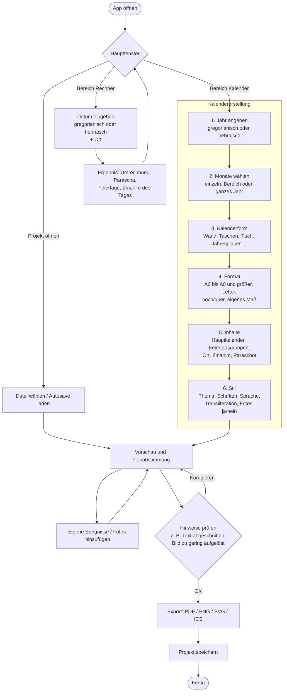
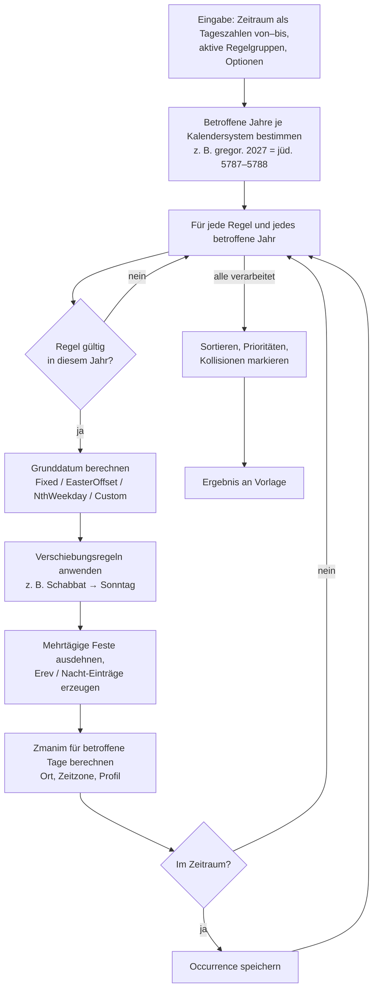
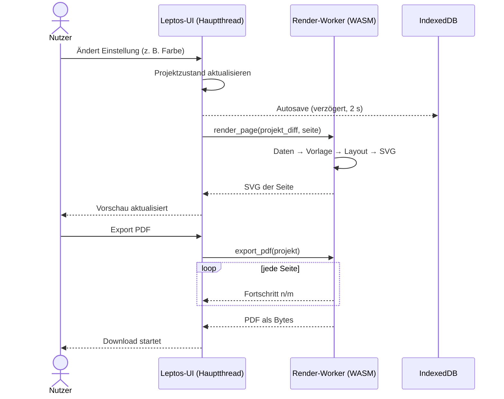
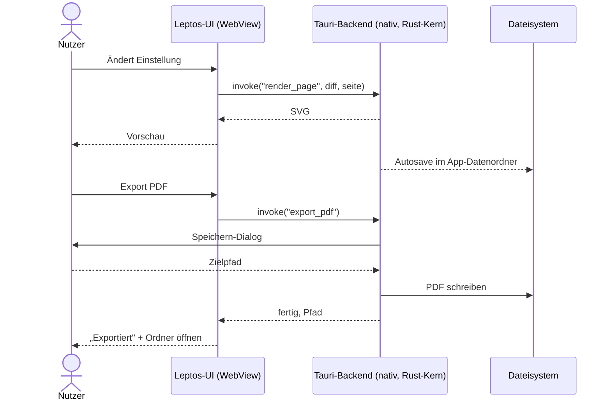
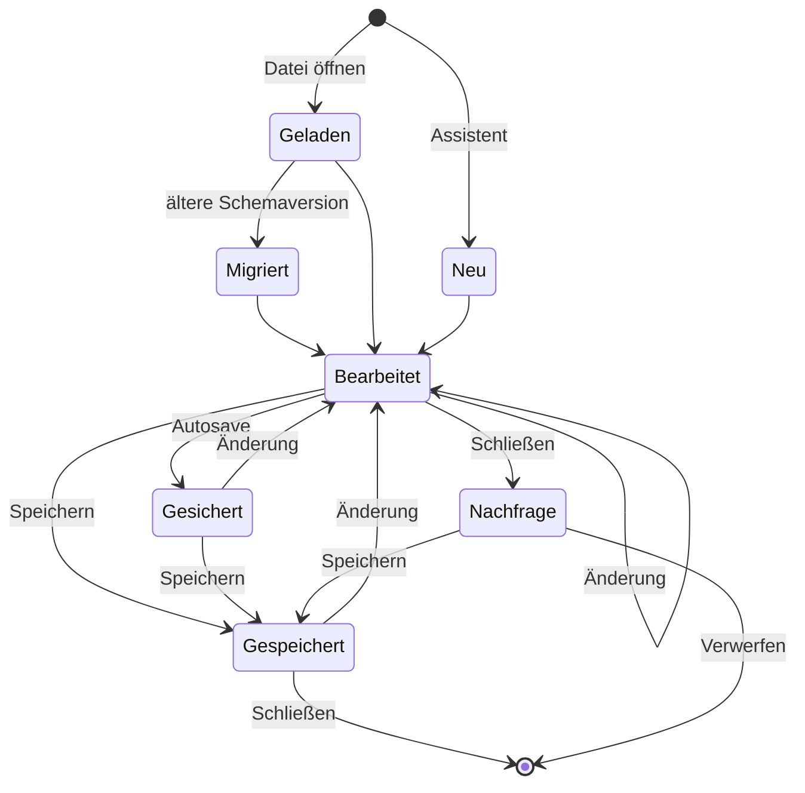
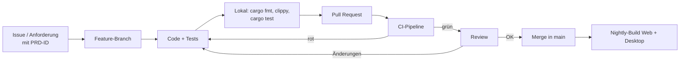
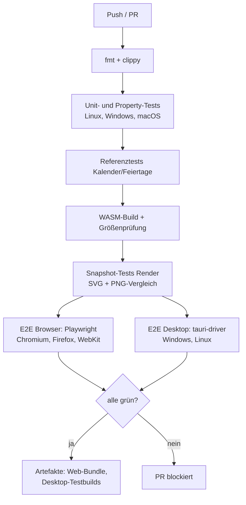
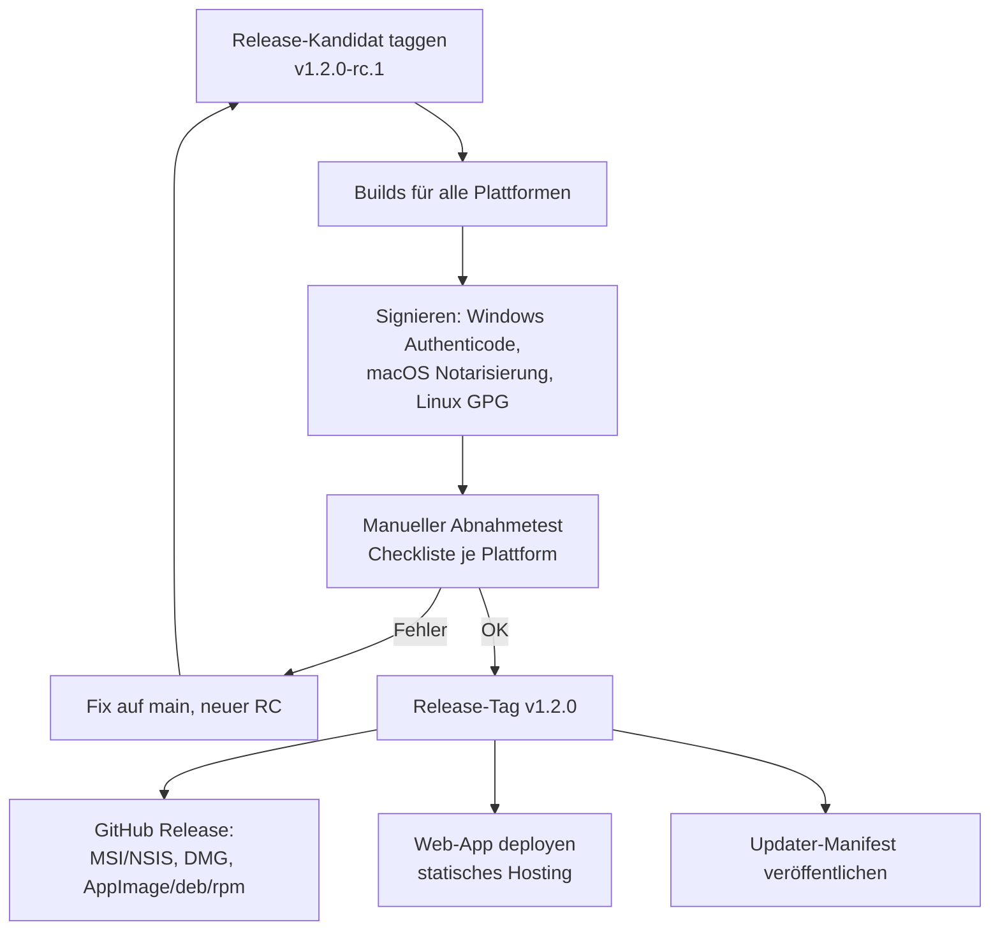
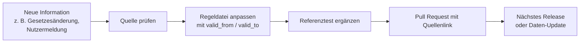

# CalendarCraft – Ablaufpläne

Version 0.3 (Entwurf), Stand 17.10.2026

Änderungen in 0.3: Nutzerablauf an die Erinnerung des Auftraggebers an Luach Pirsum angepasst (Jahr und Monate zuerst, Rechner und Kalendererstellung im Hauptfenster).

Die Diagramme sind in Mermaid geschrieben und werden z. B. auf GitHub, in VS Code (mit Erweiterung) oder in Obsidian direkt dargestellt.

## 1. Nutzerablauf

Das Hauptfenster hat zwei Bereiche, wie im Vorbild Luach Pirsum: den Rechner und die Kalendererstellung. Die Einzelheiten des Vorbilds werden im Oberflächen-Prototyp (Phase 0) mit dem Auftraggeber geklärt.

Jeder Schritt hat sinnvolle Voreinstellungen, sodass nach Jahr und Monaten sofort ein brauchbarer Kalender in der Vorschau steht (Ziel: unter 2 Sekunden, PRD NF-2). Alle Einstellungen lassen sich später ändern. Die Reihenfolge der Schritte 3 bis 6 ist als eine Seite mit Bereichen denkbar statt als starrer Assistent; das entscheidet der Prototyp.

## 2. Ablauf: Feiertage für einen Zeitraum berechnen

## 3. Ablauf: Vorschau und Export

### 3.1 Browser

### 3.2 Desktop (Tauri)

## 4. Zustände eines Projekts

Nach einem Absturz bietet die App beim Start an, den letzten Autosave wiederherzustellen.

## 5. Entwicklungsablauf

### 5.1 Arbeitsweise im Repository

Regeln:

- Jede fachliche Änderung (Kalender, Feiertag) braucht einen Test mit Referenzwert und eine Quellenangabe im Test oder in der Regeldatei.
- `main` ist jederzeit baubar. Releases entstehen aus Tags (`v0.1.0` …).
- Commits nach Conventional Commits (`feat:`, `fix:`, `docs:` …), daraus wird das Änderungsprotokoll erzeugt.

### 5.2 CI-Pipeline

### 5.3 Release-Ablauf

In der privaten Phase entfallen Signierung, Updater-Manifest und öffentliches Deployment; Releases sind dann private GitHub-Releases mit unsignierten Installern. Der volle Ablauf gilt ab der Open-Source-Veröffentlichung.

### 5.4 Pflege der Feiertagsregeln

Regeldateien sind in die App kompiliert. Ein späterer, separater Daten-Update-Kanal (signierte Regelpakete) ist möglich, aber nicht Teil des MVP.
