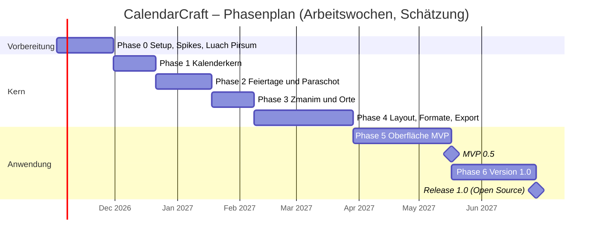

# CalendarCraft – Roadmap und Meilensteine

Version 0.3 (Entwurf), Stand 17.10.2026

Änderungen in 0.3: Luach Pirsum nur aus der Erinnerung (Prototyp statt Materialauswertung); Taschenkalender ins MVP; Ortsdatenbank und Schabbatende erweitert; Zeitbudget noch offen.

Änderungen in 0.2: ohne islamischen Kalender; Zmanim, Paraschot, Fotos, alle Papierformate und hebräische Oberfläche ins MVP; eine Person; neue Phase für die Auswertung von Luach Pirsum.

## Annahmen

Es entwickelt eine Person allein. Die Wochenangaben sind Arbeitswochen bei Vollzeit und dienen der Reihenfolge und Größenordnung, nicht als Zusage. Bei Teilzeit verlängert sich der Kalenderzeitraum entsprechend, bei 20 Stunden pro Woche etwa auf das Doppelte. Nach Phase 0 wird neu geschätzt.

Das MVP ist durch die Antworten deutlich größer geworden (Zmanim, Paraschot, Fotos, RTL-Oberfläche, alle Formate). Damit früh etwas Nutzbares entsteht, liefert jede Phase ein eigenständig verwendbares Ergebnis, zuerst als Kommandozeilenwerkzeug.

## Übersicht

Startdatum ist ein Platzhalter.

## Phase 0 – Setup, Spikes, Vorbild Luach Pirsum (ca. 4 Wochen)

- Privates GitHub-Repository, Cargo-Workspace nach Architektur-Abschnitt 4. Lizenzdatei wird erst zur Veröffentlichung gesetzt; Abhängigkeiten werden aber schon jetzt nur mit MIT/Apache-2.0/OFL-Lizenz gewählt (`cargo-deny` prüft das in der CI).
- CI auf GitHub Actions: fmt, clippy, Tests auf drei Betriebssystemen, WASM-Build.
- Spike ADR-001: Leptos-Oberfläche im Browser und in Tauri 2, mit Umschaltung Deutsch/Hebräisch (RTL).
- Spike ADR-002: A4-Monatsblatt mit Hebräisch (Nikud), RTL-Raster und Foto; dasselbe als A0. Bundle-Größe und Renderzeit messen.
- Luach Pirsum: Es gibt kein Material mehr, nur die Erinnerung des Auftraggebers (PRD 5.7). Deshalb entsteht ein klickbarer Oberflächen-Prototyp (ohne Logik) aus dieser Beschreibung: Hauptfenster mit Rechner und Kalendererstellung, Jahr und Monate zuerst. Der Auftraggeber korrigiert ihn, bis er dem Vorbild entspricht; die Änderungen fließen in PRD 5.7 und die Ablaufpläne.
- Optional: Nachfrage bei tichnut.de (Ulrich Greve), ob es noch Unterlagen oder eine Installationsdatei zu Luach Pirsum gibt. Das entscheidet der Auftraggeber, ich nehme keinen Kontakt auf.
- Zmanim-Optionen von myzmanim.com Punkt für Punkt abgleichen und in Spezifikation 3.5 eintragen.

Abnahme: ADR-001 und ADR-002 entschieden; Prototyp vom Auftraggeber freigegeben; Hello-World-Build als Web-App und unsignierte Installer für Windows, macOS, Linux aus der CI.

## Phase 1 – Kalenderkern (ca. 3 Wochen)

- `cc-calendar`: Tageszahl, gregorianisch, jüdisch (Molad, Dechijot, Jahrestypen).
- Prüfimplementierung nach *Calendrical Calculations*, Vergleichstests gegen ICU4X.
- Hebräische Zahlbuchstaben, Monatsnamen in de/en/he, Transliteration aschkenasisch/sefardisch (`cc-i18n`).
- `cc-cli convert 2026-10-17`.

Abnahme: Umrechnung 1900–2200 deckungsgleich mit Referenz; Property-Tests grün.

## Phase 2 – Feiertage und Paraschot (ca. 4 Wochen)

- Regelformat (RON) und Regel-Engine.
- Regeldateien: jüdisch (inkl. Verschiebungen, Diaspora/Israel, besondere Schabbatot, Rosch Chodesch, Omer, Molad), Israel gesetzlich, Deutschland nach Bundesland, christliche Gedenktage.
- Paraschot und Haftarot (aschkenasisch/sefardisch).
- Eigene Ereignisse, Jahrzeit, Bar-/Bat-Mizwa-Rechner.
- `cc-cli holidays --year 2027 --sets jewish,il,de-HE`.

Abnahme: Feiertage und Paraschot 1950–2100 deckungsgleich mit Hebcal; deutsche Feiertage 2000–2050 gegen Referenzliste; jede Regel mit Quelle.

## Phase 3 – Zmanim und Orte (ca. 3 Wochen)

- `cc-astro`: Sonnenstand, Auf- und Untergang, Tiefstände, Saisonstunden, Mondphasen, Tekufot.
- Zmanim-Profile, Sonderfälle hoher Breiten, zweiter Feiertagsabend.
- Ortsdatenbank und Zeitzonen, offline: deutsche Großgemeinden und große jüdische Gemeinden weltweit, freie Eingabe von Längen-/Breitengrad; Ortsvoreinstellungen (Frankfurt 30 Minuten Kerzenzündung).
- Schabbatende in den Arten nach myzmanim.com wählbar.
- `cc-cli zmanim --city Frankfurt --year 2027`.

Abnahme: Zmanim für mindestens zehn Orte (u. a. Frankfurt, Berlin, Jerusalem, New York, Tromsø) über ein Jahr höchstens 1 Minute Abweichung von Hebcal/KosherJava mit gleichen Parametern.

## Phase 4 – Layout, Formate, Export (ca. 7 Wochen)

- Umsetzung der in ADR-002 gewählten Engine.
- Vorlagen MVP: Wandkalender-Monatsblatt, Taschenkalender, Jahresübersicht, Tischkalender, Schabbat-/Feiertagszeitentafel.
- Geschwindigkeit: Kalender mit allen Monaten in unter 2 Sekunden in der Vorschau (Messung in der CI, siehe Teststrategie).
- Alle Papierformate (DIN A6 bis 4A0, US-Formate, eigene Maße); Vorlagen skalieren Schrift und Raster.
- Fotos je Monat bzw. Deckblatt, optional; Auflösungswarnung.
- RTL-Raster, Kollisionsbehandlung, Zmanim und Parascha in Zellen oder Tabellen.
- Export PDF, SVG, PNG; Snapshot-Tests.
- `cc-cli render projekt.ccal --out kalender.pdf`.

Abnahme: Wandkalender mit Fotos, Paraschot und Kerzenzündezeiten für Frankfurt als PDF in A4 und A0; auf allen drei Betriebssystemen identisch.

## Phase 5 – Oberfläche MVP (ca. 7 Wochen)

- Bildschirmaufbau und Abläufe nach dem freigegebenen Prototyp (Luach Pirsum).
- Editor mit Live-Vorschau, Datumsumrechner, Ortsauswahl, Fotoverwaltung.
- Projekt speichern/öffnen, Autosave, Wiederherstellung.
- UI-Sprachen Deutsch, Englisch, Hebräisch (RTL).
- PWA (offline), unsignierte Desktop-Installer.
- E2E-Tests der Hauptabläufe in allen drei Sprachen.

Abnahme MVP 0.5: Alle Muss-Anforderungen (Prio M) erfüllt; Erfolgskriterien aus PRD Abschnitt 8 vom Auftraggeber bestätigt.

## Phase 6 – Version 1.0 und Veröffentlichung (ca. 6 Wochen)

- Weitere Kalenderformen: Wochenkalender, Desktop-Hintergrund.
- Christliche Gedenktage als abschaltbare Gruppe.
- Vorlageneditor.
- Druckoptionen: Beschnitt, Schnittmarken, Kacheln großer Formate, Bindungsreihenfolge.
- .ics-Export und -Import, CSV-Import.
- Barrierefreiheit (WCAG 2.1 AA), dunkler Modus.
- Vorbereitung Open Source: Lizenz wählen (Vorschlag MIT/Apache-2.0 dual), Repository öffentlich, GitHub Pages, Code-Signierung, Auto-Update.

Abnahme 1.0: Alle Soll-Anforderungen erfüllt oder bewusst verschoben; keine offenen Fehler der Schwere „falsches Datum/falsche Zeit"; Release-Checkliste je Plattform abgearbeitet.

## Danach (Prio K, ohne Reihenfolge)

Islamischer Kalender, Lernzyklen (Daf Jomi), Familienplaner, Abreiß- und Geburtstagskalender, Schulferien, PDF/X und CMYK, mobile Apps über Tauri 2.

## Definition of Done (für jede Aufgabe)

- Code formatiert, ohne clippy-Warnungen.
- Tests vorhanden und grün; fachliche Regeln mit Referenzwert und Quelle.
- Läuft in Browser und Desktop (sofern UI betroffen).
- Texte in Deutsch, Englisch und Hebräisch übersetzt; Oberfläche in RTL geprüft.
- Dokumentation (Code-Doku, bei Bedarf `docs/`) aktualisiert.
